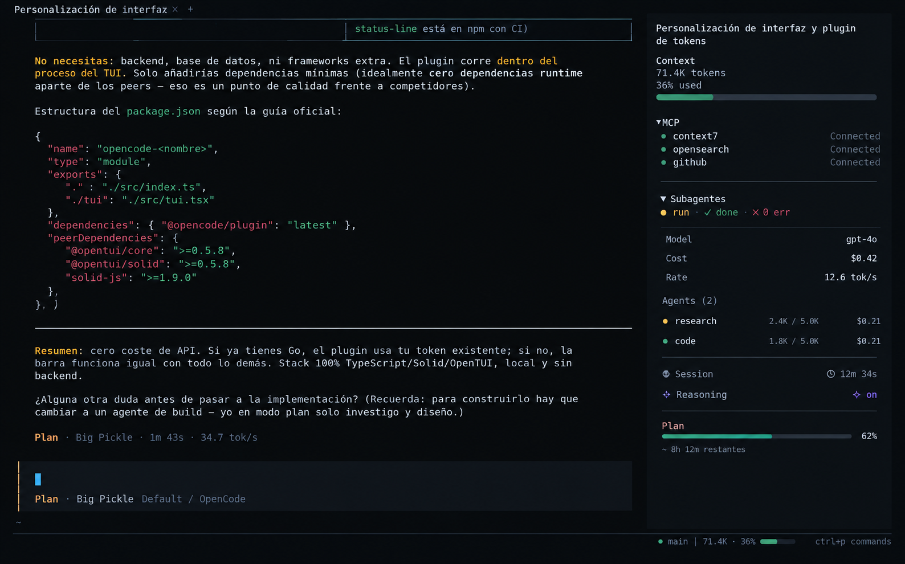

# Hush

Minimal telemetry for the [OpenCode](https://opencode.ai) TUI. Quiet while everything is healthy, specific when something needs attention.



> **Status:** v0.1.0 — sidebar telemetry panel. Every figure comes from the plugin context; nothing is estimated, scraped, or fetched from outside the local runtime.

## What it shows

| Section | Content | Where it comes from |
| --- | --- | --- |
| **Context** | tokens in the window, model limit, percentage, pressure bar | last assistant message carrying usage, after the last completed compaction and before the revert boundary; limit from `ModelInfo.limit.context` |
| **Git** | current branch | `data.location.vcs.info()` |
| **Agents** | child sessions with state, model, tokens and cost | `data.session.family()`, `session.list()`, `session.status()` |
| **Meta** | model, session cost, live tok/s, session tokens, elapsed time, reasoning | session store plus `session.usage.updated` and `session.reasoning.*` events |

Sections with no data render nothing. A missing limit still shows tokens, just without a percentage.

### Semantics that matter

- **Context ≠ session total.** Context is the tokens the current window holds. The cumulative figure is labelled `Tokens` in the summary block, so the two are never mixed.
- **Cost** is the family total the host reports for the root session, so subagent spend is counted once.
- **Generation speed** is sampled from successive `session.usage.updated` events over a rolling 8 s window. It disappears when there are too few samples, they are closer than 400 ms, they are stale, or they show no growth.
- **Reasoning** reads `active` while reasoning content streams (`session.reasoning.started` → `ended` / idle / execution end) and `supported` when the model's provider compatibility declares a reasoning field. It is never inferred from a model name or from timing.
- **Pressure** is the only adaptive behavior in this version: `calm` below 70%, `warn` at 70%, `critical` at 90%. It colors the percentage and the bar, and the percentage itself carries the same information.

## Limitations

- **No duplicated host data.** OpenCode already renders MCP status and the prompt footer, so Hush does not claim either slot. The sidebar panel adds only context, agents, Git and the secondary session metrics.
- **Narrow terminals use a proxy.** The sidebar slot does not publish its own width, so the wide/compact breakpoint (`90` columns) reads the render surface width. Narrow terminals lose per-agent model first; the primary metrics never drop.
- **Git is branch only.** The plugin API exposes `VcsInfo` with the current branch, not a diff count. Hush therefore never claims dirty files or `+n −n`.
- **Plan/quota is not implemented.** The plugin API does not expose plan usage. Hush does not call undocumented endpoints, read credentials, or infer a plan from cost.
- **Subagent errors are a state, not a message.** A failed agent shows `✗` and counts under `err`; the host's structured error text is not rendered.
- **Reasoning is a capability, not a switch.** If a variant disables reasoning for a model whose provider declares support, the panel still says `supported`.

## Configuration

Add the package to the `plugins` array in `~/.config/opencode/cli.json`:

```json
{
  "$schema": "https://opencode.ai/v2/cli.json",
  "plugins": ["opencode-hush"]
}
```

### Run from a local checkout

OpenCode 2 discovers local plugins from `~/.config/opencode/plugins/`. A
directory there must provide a server entrypoint **and** a TUI entrypoint:

```text
~/.config/opencode/plugins/hush/
  server.ts   # required by the host; Hush is TUI-only, so this one is inert
  tui.tsx     # re-exports the plugin from this repository
```

`tui.tsx` is a one-line shim, so edits in `src/` are picked up without a build:

```ts
export { default } from "../../../../Desktop/Hush/src/tui.tsx"
```

## Development

Requires Node.js 20+ and pnpm.

```sh
pnpm install
pnpm typecheck
pnpm test
pnpm build
```

## Structure

```
src/
  tui.tsx        TUI entrypoint: claims slots and releases them on deactivate
  telemetry.ts   Reactive session state: store reads, clock, event subscriptions
  panel.tsx      Presentation: sidebar panel
  core/
    format.ts    Token, percent, duration, cost and rate formatting
    usage.ts     Token totals, context window, pressure, generation rate
    agents.ts    Subagent derivation and rollup
test/            Vitest unit tests
scripts/         Build helpers
docs/design/     Design references
```

## License

MIT
